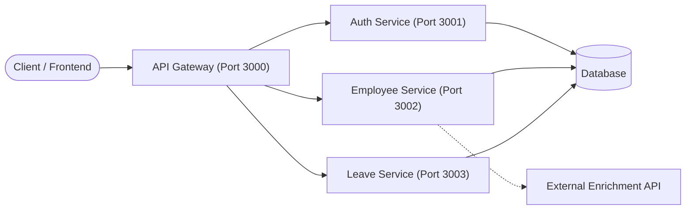

# ออกแบบสถาปัตยกรรม Microservices ของระบบ Microservices HR System

## การแบ่งบริการ

| บริการ               | ความรับผิดชอบ                                                                                                                     | Endpoint หลัก                                          |
| -------------------- | --------------------------------------------------------------------------------------------------------------------------------- | ------------------------------------------------------ |
| **API Gateway**      | เป็นจุดรับ Request ทั้งหมดจาก Client, จัดการ Routing ไปยัง Service ต่างๆ, ตรวจสอบ Authentication (JWT) และเช็กสิทธิ์ (Role-based) | `/api/auth/*`, `/api/employees/*`, `/api/leaves/*`     |
| **Auth Service**     | จัดการผู้ใช้งาน, การสมัครสมาชิก (Register), การเข้าสู่ระบบ (Login) และการสร้าง Token                                              | `POST /register`, `POST /login`, `GET /me`             |
| **Employee Service** | จัดการข้อมูลส่วนตัวพนักงาน, การลงเวลาทำงาน (Attendance) และดึงข้อมูลเสริมจาก API ภายนอก                                           | `GET /`, `POST /:id/attendance`, `GET /:id/enrichment` |
| **Leave Service**    | จัดการระบบการลางานของพนักงาน, บันทึกคำขอลา และให้ Admin อนุมัติ/ปฏิเสธคำขอ                                                        | `GET /`, `PATCH /:id`                                  |

## แผนภาพสถาปัตยกรรม

## รูปแบบการสื่อสาร

| จาก              | ไป                                        | รูปแบบ                  | เหตุผล                                                                                                |
| ---------------- | ----------------------------------------- | ----------------------- | ----------------------------------------------------------------------------------------------------- |
| Client           | API Gateway                               | Synchronous (REST/HTTP) | Client (เช่น Web/App) ต้องการทราบผลลัพธ์ทันทีว่า Request สำเร็จหรือไม่                                |
| API Gateway      | Internal Services (Auth, Employee, Leave) | Synchronous (REST/HTTP) | Gateway ทำหน้าที่เป็น Reverse Proxy แบบตรงไปตรงมา ต้องรอ Response จาก Service ย่อยเพื่อส่งกลับ Client |
| Employee Service | External Enrichment API                   | Synchronous (REST/HTTP) | จำเป็นต้องดึงข้อมูลมาประกอบ (Enrich) ทันทีเมื่อมีการเรียกดูข้อมูลพนักงาน                              |

## จุดที่ต้องมี Resilience

| บริการที่เรียก   | บริการปลายทาง               | ต้องมี Retry/Timeout/Fallback หรือไม่   | เหตุผล                                                                                                                                                                                                                               |
| ---------------- | --------------------------- | --------------------------------------- | ------------------------------------------------------------------------------------------------------------------------------------------------------------------------------------------------------------------------------------ |
| API Gateway      | Internal Services (ทั้งหมด) | **Timeout** และ **Fallback**            | หาก Service ย่อยล่มหรือตอบสนองช้า Gateway ต้องตั้ง Timeout (เช่น 5-10 วินาที) และ Fallback กลับไปเป็น Error 503 หรือ 504 เพื่อไม่ให้ Gateway Thread ค้างและระบบพังตามกัน (Cascading Failure)                                         |
| Employee Service | External Enrichment API     | **Retry**, **Timeout** และ **Fallback** | API ภายนอกมีความเสี่ยงสูงที่จะเชื่อมต่อไม่ได้ ควรมี Timeout ที่สั้น มี Retry เล็กน้อย (1-2 ครั้ง) และถ้ายังล้มเหลว ควรมี Fallback โดยการคืนค่าแค่ข้อมูลพนักงานหลัก และปล่อยช่องข้อมูลเสริมเป็นค่าว่างแทนที่จะ Error 500 ทั้ง Request |
